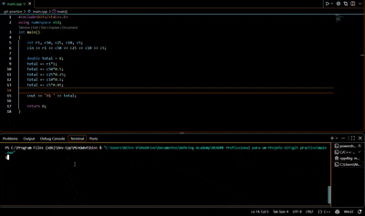

# Contador de Moedas 🪙

## 📝 Descrição
O **Contador de Moedas** é um programa desenvolvido em C++ com o objetivo de calcular o valor total em reais ($) a partir da quantidade de moedas que você possui (R$ 1,00, R$ 0,50, R$ 0,25, R$ 0,10 e R$ 0,05).

Este programa foi pensado para:
* **Pequenos comerciantes e autônomos:** Donos de bancas de jornal, mercadinhos, vendedores ambulantes e feirantes.
* **Organização pessoal:** Pessoas que guardam moedas em cofrinhos e desejam contabilizá-las de forma prática.

---

## 📸 Demonstração
<!-- Substitua o link/caminho abaixo pela sua imagem ou GIF demonstrando o programa -->


---

## 🛠️ Instalação e Pré-requisitos
Para rodar este programa, você precisará de um ambiente ou compilador que suporte **C++**.

### Pré-requisitos recomendados:
* **VS Code** com a extensão *C/C++* (Microsoft)
* **Dev C++**
* Ou qualquer compilador C++ de sua preferência (como `g++`)

### Passos para instalação:
1. Clone este repositório para a sua máquina local:
   ```bash
   git clone [https://github.com/seu-usuario/git-practice.git](https://github.com/seu-usuario/git-practice.git)
2. Acesse a pasta do projeto:
   cd git-practice

## Uso e Exemplos:
Como compilar e executar:
   1. Abra o terminal na pasta do projeto.
   2. Compile o código com o g++:
      g++ main.cpp -o contador
   3. Execute o programa:
      ./contador
   Exemplo de execução:
      Entrada (quantidade de moedas de R$ 1,00; R$ 0,50; R$ 0,25; R$ 0,10; R$ 0,05):
      10 5 4 10 6
      Saída:
      R$ 14.8

## Estrutura do Projeto

```text
git-practice/
├── .vscode/              # Configurações do ambiente no VS Code
├── assets/
│   └── demonstracao.gif  # GIF ou imagem de demonstração do programa
├── main.cpp              # Código-fonte do programa em C++
├── README.md             # Documentação do projeto
└── LICENSE               # Licença do projeto
```

## Licença
Este projeto está sob a licença [MIT](https://choosealicense.com/licenses/mit/), especificada no arquivo LICENSE.